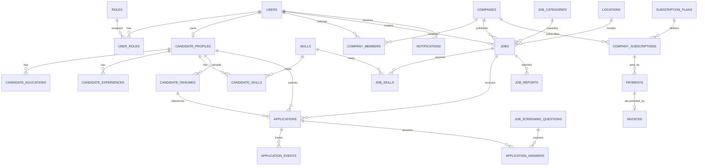

# Ethiojobs-Style Job Portal — Backend Architecture & Database Specification

## 1. Project Goal

Build a job portal inspired by the public functionality of Ethiojobs.net for employers to publish vacancies and candidates to find and apply for jobs.

Implement equivalent core functionality without copying proprietary source code, private data, or branding. This document is a proposed architecture based on publicly visible features; it is **not** Ethiojobs' actual internal schema.

### Main capabilities

- Public job search, filtering, pagination, and job detail pages
- Company directory and employer profiles
- Candidate accounts, profiles, CVs, education, experience, and skills
- Employer accounts, company membership, and job management
- Applications and applicant tracking
- Job moderation and employer verification
- Saved jobs and job alerts
- Notifications
- Optional employer subscriptions, payments, and invoices
- Admin dashboard, reporting, and audit logs

## 2. Recommended Architecture

Use a **modular monolith** initially: one backend application organized into modules and one relational database.

### Suggested stack

- Frontend: React + Vite
- Backend: Node.js with Express or NestJS
- Database: PostgreSQL
- File storage: private object storage for CVs, logos, and documents
- Notifications: email provider; optional SMS provider
- Background jobs: queue/worker for alerts and scheduled tasks
- Search: PostgreSQL full-text search initially; add a dedicated search engine only when justified

### High-level flow

1. Frontend: public website, candidate portal, employer dashboard, admin panel
2. REST API: authentication, validation, permissions, business rules
3. Business modules: users, companies, jobs, applications, payments, notifications, administration
4. PostgreSQL: relational tables, foreign keys, constraints, indexes, and transactions
5. Supporting services: private file storage, email/SMS, background jobs, optional payment provider

## 3. Database Conventions

- Use UUID primary keys for main entities.
- Add `created_at TIMESTAMPTZ NOT NULL DEFAULT now()` and `updated_at TIMESTAMPTZ NOT NULL DEFAULT now()` to mutable main records.
- Use foreign keys for relationships.
- Use `NUMERIC(12,2)` for monetary values and an explicit three-character currency code, e.g. `ETB`.
- Use `DATE` for deadlines and date-only facts; use `TIMESTAMPTZ` for event timestamps.
- Store uploaded file metadata and storage keys in PostgreSQL, not raw file bytes.
- Store password hashes only, never plaintext passwords.
- Use controlled status values through enums or validated `VARCHAR` values and application-level state transitions.
- Normalize categories, skills, and locations into relational tables rather than one large JSON column.
- Use JSONB only for genuinely flexible values, such as screening question choices or limited provider metadata.
- Enforce uniqueness and required fields in the database as well as in the API.
- All database schema changes must be versioned as migrations.
- Use UTC timestamps internally and display them in the user's selected/local timezone.

## 4. Tables and Fields

The schema below is a detailed starting point. Agents may add fields when justified, but should preserve the stated relationships and security rules.

### A. Accounts and Candidate Profiles

#### `users`

One identity for each registered person.

| Column | Type | Rules |
|---|---|---|
| `id` | UUID | PK |
| `email` | VARCHAR(255) | Nullable if phone-only login is supported; unique when present |
| `phone` | VARCHAR(30) | Nullable; unique when present |
| `password_hash` | TEXT | Required for password-based accounts |
| `first_name` | VARCHAR(100) | Required |
| `last_name` | VARCHAR(100) | Required |
| `account_status` | VARCHAR(20) | `active`, `suspended`, `pending` |
| `email_verified_at` | TIMESTAMPTZ | Nullable |
| `phone_verified_at` | TIMESTAMPTZ | Nullable |
| `last_login_at` | TIMESTAMPTZ | Nullable |
| `created_at` | TIMESTAMPTZ | Required |
| `updated_at` | TIMESTAMPTZ | Required |

Require at least one login identifier. Normalize email and phone values before uniqueness checks.

#### `roles`

| Column | Type | Rules |
|---|---|---|
| `id` | SMALLINT | PK |
| `name` | VARCHAR(50) | Unique; e.g. `candidate`, `employer`, `admin`, `moderator` |
| `description` | TEXT | Optional |

#### `user_roles`

A user may have multiple roles.

| Column | Type | Rules |
|---|---|---|
| `user_id` | UUID | PK part; FK → `users.id` |
| `role_id` | SMALLINT | PK part; FK → `roles.id` |
| `assigned_at` | TIMESTAMPTZ | Required |

Composite PK: (`user_id`, `role_id`).

#### `candidate_profiles`

One extended profile per job seeker.

| Column | Type | Rules |
|---|---|---|
| `id` | UUID | PK |
| `user_id` | UUID | Unique FK → `users.id` |
| `headline` | VARCHAR(200) | Optional professional title |
| `summary` | TEXT | Optional |
| `date_of_birth` | DATE | Optional; restrict access |
| `gender` | VARCHAR(30) | Optional |
| `country` | VARCHAR(100) | Optional |
| `region` | VARCHAR(100) | Optional |
| `city` | VARCHAR(100) | Optional |
| `address` | TEXT | Optional and private |
| `years_experience` | NUMERIC(4,1) | Optional |
| `current_salary` | NUMERIC(12,2) | Optional and private |
| `salary_currency` | CHAR(3) | Optional |
| `expected_salary` | NUMERIC(12,2) | Optional |
| `availability_status` | VARCHAR(30) | E.g. `immediate`, `notice_period`, `not_available` |
| `profile_visibility` | VARCHAR(20) | `public`, `employers`, `private` |
| `created_at` | TIMESTAMPTZ | Required |
| `updated_at` | TIMESTAMPTZ | Required |

#### `candidate_educations`

A candidate can have multiple education records.

| Column | Type | Rules |
|---|---|---|
| `id` | UUID | PK |
| `candidate_id` | UUID | FK → `candidate_profiles.id` |
| `institution` | VARCHAR(255) | Required |
| `qualification` | VARCHAR(150) | Optional |
| `field_of_study` | VARCHAR(150) | Optional |
| `start_date` | DATE | Optional |
| `end_date` | DATE | Optional |
| `is_current` | BOOLEAN | Default false |
| `grade` | VARCHAR(100) | Optional |
| `description` | TEXT | Optional |

#### `candidate_experiences`

| Column | Type | Rules |
|---|---|---|
| `id` | UUID | PK |
| `candidate_id` | UUID | FK → `candidate_profiles.id` |
| `company_name` | VARCHAR(255) | Required |
| `job_title` | VARCHAR(200) | Required |
| `employment_type` | VARCHAR(50) | Optional |
| `start_date` | DATE | Required |
| `end_date` | DATE | Nullable |
| `is_current` | BOOLEAN | Default false |
| `description` | TEXT | Optional |

#### `skills`

| Column | Type | Rules |
|---|---|---|
| `id` | UUID | PK |
| `name` | VARCHAR(100) | Unique normalized skill name |

#### `candidate_skills`

| Column | Type | Rules |
|---|---|---|
| `candidate_id` | UUID | PK part; FK → `candidate_profiles.id` |
| `skill_id` | UUID | PK part; FK → `skills.id` |
| `proficiency_level` | VARCHAR(30) | Optional |
| `years_experience` | NUMERIC(4,1) | Optional |

Composite PK: (`candidate_id`, `skill_id`).

### B. Companies and Employer Accounts

#### `companies`

A company is separate from the user who manages it.

| Column | Type | Rules |
|---|---|---|
| `id` | UUID | PK |
| `name` | VARCHAR(255) | Required |
| `slug` | VARCHAR(255) | Unique URL identifier |
| `logo_file_id` | UUID | FK → `files.id`, nullable |
| `industry_id` | UUID | FK → `industries.id`, nullable |
| `description` | TEXT | Optional |
| `website_url` | TEXT | Optional |
| `email` | VARCHAR(255) | Optional public contact |
| `phone` | VARCHAR(30) | Optional |
| `country` | VARCHAR(100) | Default `Ethiopia` if appropriate |
| `region` | VARCHAR(100) | Optional |
| `city` | VARCHAR(100) | Optional |
| `address` | TEXT | Optional |
| `company_size` | VARCHAR(50) | Optional |
| `founded_year` | SMALLINT | Optional |
| `verification_status` | VARCHAR(20) | `pending`, `verified`, `rejected` |
| `verified_at` | TIMESTAMPTZ | Nullable |
| `is_featured` | BOOLEAN | Default false; admin-controlled |
| `created_at` | TIMESTAMPTZ | Required |
| `updated_at` | TIMESTAMPTZ | Required |

#### `company_members`

Connects users to the companies they may manage.

| Column | Type | Rules |
|---|---|---|
| `id` | UUID | PK |
| `company_id` | UUID | FK → `companies.id` |
| `user_id` | UUID | FK → `users.id` |
| `member_role` | VARCHAR(30) | `owner`, `recruiter`, `hiring_manager` |
| `status` | VARCHAR(20) | `invited`, `active`, `revoked` |
| `invited_by` | UUID | FK → `users.id`, nullable |
| `created_at` | TIMESTAMPTZ | Required |

Unique constraint: (`company_id`, `user_id`).

#### `company_verification_documents`

| Column | Type | Rules |
|---|---|---|
| `id` | UUID | PK |
| `company_id` | UUID | FK → `companies.id` |
| `file_id` | UUID | FK → `files.id` |
| `document_type` | VARCHAR(50) | E.g. registration/license |
| `review_status` | VARCHAR(20) | `pending`, `approved`, `rejected` |
| `reviewed_by` | UUID | FK → `users.id`, nullable |
| `reviewed_at` | TIMESTAMPTZ | Nullable |
| `review_note` | TEXT | Optional |
| `created_at` | TIMESTAMPTZ | Required |

### C. Job Classifications and Locations

#### `industries`

| Column | Type | Rules |
|---|---|---|
| `id` | UUID | PK |
| `name` | VARCHAR(150) | Required |
| `slug` | VARCHAR(180) | Unique |
| `parent_id` | UUID | FK → `industries.id`, nullable |
| `is_active` | BOOLEAN | Default true |

#### `job_categories`

| Column | Type | Rules |
|---|---|---|
| `id` | UUID | PK |
| `name` | VARCHAR(150) | Required |
| `slug` | VARCHAR(180) | Unique |
| `parent_id` | UUID | FK → `job_categories.id`, nullable |
| `description` | TEXT | Optional |
| `is_active` | BOOLEAN | Default true |
| `sort_order` | INTEGER | Default 0 |

#### `locations`

| Column | Type | Rules |
|---|---|---|
| `id` | UUID | PK |
| `country` | VARCHAR(100) | Required |
| `region` | VARCHAR(100) | Optional |
| `city` | VARCHAR(100) | Optional |
| `sub_city` | VARCHAR(100) | Optional |
| `name` | VARCHAR(200) | Display name |
| `slug` | VARCHAR(220) | Unique |

Support Ethiopian regions and cities, and allow jobs outside Ethiopia.

### D. Jobs

#### `jobs`

The core vacancy table.

| Column | Type | Rules |
|---|---|---|
| `id` | UUID | PK |
| `company_id` | UUID | FK → `companies.id` |
| `created_by` | UUID | FK → `users.id` |
| `category_id` | UUID | FK → `job_categories.id` |
| `location_id` | UUID | FK → `locations.id`, nullable |
| `title` | VARCHAR(255) | Required |
| `slug` | VARCHAR(280) | Unique |
| `reference_code` | VARCHAR(100) | Optional; unique per company if supplied |
| `summary` | TEXT | Optional short description |
| `description` | TEXT | Required full description |
| `responsibilities` | TEXT | Optional |
| `requirements` | TEXT | Optional |
| `education_requirement` | TEXT | Optional |
| `experience_min_years` | NUMERIC(4,1) | Nullable |
| `experience_max_years` | NUMERIC(4,1) | Nullable |
| `employment_type` | VARCHAR(40) | E.g. `full_time`, `part_time`, `contract`, `internship` |
| `career_level` | VARCHAR(50) | E.g. `entry`, `junior`, `mid`, `senior`, `executive` |
| `workplace_type` | VARCHAR(30) | `on_site`, `hybrid`, `remote` |
| `salary_min` | NUMERIC(12,2) | Optional |
| `salary_max` | NUMERIC(12,2) | Optional |
| `salary_currency` | CHAR(3) | Optional, e.g. `ETB` |
| `salary_visibility` | BOOLEAN | Default false |
| `vacancies_count` | INTEGER | Default 1; must be >= 1 |
| `application_method` | VARCHAR(30) | `internal`, `external_url`, `email` |
| `application_url` | TEXT | Nullable |
| `application_email` | VARCHAR(255) | Nullable |
| `application_instructions` | TEXT | Optional |
| `posted_at` | TIMESTAMPTZ | Nullable until published |
| `application_deadline` | DATE | Required or explicitly configured as optional |
| `status` | VARCHAR(20) | `draft`, `pending_review`, `published`, `rejected`, `closed`, `archived` |
| `is_featured` | BOOLEAN | Default false; admin-controlled or subscription-controlled |
| `is_easy_apply` | BOOLEAN | Default false |
| `approved_by` | UUID | FK → `users.id`, nullable |
| `approved_at` | TIMESTAMPTZ | Nullable |
| `created_at` | TIMESTAMPTZ | Required |
| `updated_at` | TIMESTAMPTZ | Required |

Business rules:
- Only authorized company members can create or update jobs for that company.
- Check subscription/allowance before accepting a new job if paid plans are enabled.
- A job is public only when `status = 'published'` and it satisfies publication and deadline rules.
- Validate `salary_min <= salary_max` when both are supplied.
- Validate `experience_min_years <= experience_max_years` when both are supplied.
- Preserve applications and history when a job closes or is archived.
- A moderation state transition must be validated by the backend.

#### `job_skills`

| Column | Type | Rules |
|---|---|---|
| `job_id` | UUID | PK part; FK → `jobs.id` |
| `skill_id` | UUID | PK part; FK → `skills.id` |
| `is_required` | BOOLEAN | Default true |

Composite PK: (`job_id`, `skill_id`).

#### `job_category_mappings` (optional)

Use only if a job may belong to multiple categories. If each job has one category, use `jobs.category_id` and omit this table.

| Column | Type | Rules |
|---|---|---|
| `job_id` | UUID | PK part; FK → `jobs.id` |
| `category_id` | UUID | PK part; FK → `job_categories.id` |

#### `job_screening_questions`

| Column | Type | Rules |
|---|---|---|
| `id` | UUID | PK |
| `job_id` | UUID | FK → `jobs.id` |
| `question_text` | TEXT | Required |
| `question_type` | VARCHAR(30) | `text`, `number`, `yes_no`, `single_choice`, `multiple_choice` |
| `options` | JSONB | Choices only where applicable |
| `is_required` | BOOLEAN | Default true |
| `sort_order` | INTEGER | Default 0 |

### E. Files and Resumes

#### `files`

Central metadata table for CVs, profile images, company logos, and documents.

| Column | Type | Rules |
|---|---|---|
| `id` | UUID | PK |
| `owner_user_id` | UUID | FK → `users.id`, nullable |
| `storage_key` | TEXT | Private storage key/path |
| `original_filename` | VARCHAR(255) | Required |
| `mime_type` | VARCHAR(100) | Required |
| `size_bytes` | BIGINT | Required |
| `file_category` | VARCHAR(40) | `cv`, `logo`, `profile_image`, `document` |
| `is_private` | BOOLEAN | Default true |
| `created_at` | TIMESTAMPTZ | Required |

Create `files` before `companies` if `companies.logo_file_id` is a real foreign key. Alternatively, create the company table first and add that FK in a later migration.

#### `candidate_resumes`

A candidate can maintain multiple CV versions.

| Column | Type | Rules |
|---|---|---|
| `id` | UUID | PK |
| `candidate_id` | UUID | FK → `candidate_profiles.id` |
| `file_id` | UUID | FK → `files.id` |
| `title` | VARCHAR(200) | E.g. `General CV` |
| `is_default` | BOOLEAN | Default false |
| `created_at` | TIMESTAMPTZ | Required |

Use a partial unique index to allow at most one default resume per candidate.

### F. Applications and Applicant Tracking

#### `applications`

Connects a candidate to a vacancy.

| Column | Type | Rules |
|---|---|---|
| `id` | UUID | PK |
| `job_id` | UUID | FK → `jobs.id` |
| `candidate_id` | UUID | FK → `candidate_profiles.id` |
| `resume_id` | UUID | FK → `candidate_resumes.id`, nullable |
| `cover_letter` | TEXT | Optional |
| `status` | VARCHAR(30) | `submitted`, `reviewing`, `shortlisted`, `interview`, `offered`, `hired`, `rejected`, `withdrawn` |
| `applied_at` | TIMESTAMPTZ | Required |
| `updated_at` | TIMESTAMPTZ | Required |
| `withdrawn_at` | TIMESTAMPTZ | Nullable |

Unique constraint: (`job_id`, `candidate_id`) to prevent duplicate applications unless reapplication is deliberately supported.

The backend must ensure that the resume referenced by an application belongs to that candidate. Preserve the exact CV version used when applying.

#### `application_answers`

| Column | Type | Rules |
|---|---|---|
| `id` | UUID | PK |
| `application_id` | UUID | FK → `applications.id` |
| `question_id` | UUID | FK → `job_screening_questions.id` |
| `answer_text` | TEXT | Required where question is required |
| `created_at` | TIMESTAMPTZ | Required |

Unique constraint: (`application_id`, `question_id`). Validate that the question belongs to the job being applied for.

#### `application_events`

Append-only history of application status changes.

| Column | Type | Rules |
|---|---|---|
| `id` | UUID | PK |
| `application_id` | UUID | FK → `applications.id` |
| `changed_by` | UUID | FK → `users.id` |
| `old_status` | VARCHAR(30) | Nullable for first event |
| `new_status` | VARCHAR(30) | Required |
| `note` | TEXT | Optional internal note |
| `created_at` | TIMESTAMPTZ | Required |

#### `interviews` (recommended)

| Column | Type | Rules |
|---|---|---|
| `id` | UUID | PK |
| `application_id` | UUID | FK → `applications.id` |
| `scheduled_by` | UUID | FK → `users.id` |
| `interview_type` | VARCHAR(30) | `in_person`, `phone`, `video` |
| `scheduled_at` | TIMESTAMPTZ | Required |
| `location_or_link` | TEXT | Optional |
| `status` | VARCHAR(20) | `scheduled`, `completed`, `cancelled` |
| `feedback` | TEXT | Restricted internal feedback |

### G. Saved Jobs, Alerts, and Analytics

#### `saved_jobs`

| Column | Type | Rules |
|---|---|---|
| `candidate_id` | UUID | PK part; FK → `candidate_profiles.id` |
| `job_id` | UUID | PK part; FK → `jobs.id` |
| `created_at` | TIMESTAMPTZ | Required |

Composite PK: (`candidate_id`, `job_id`).

#### `job_alerts`

| Column | Type | Rules |
|---|---|---|
| `id` | UUID | PK |
| `candidate_id` | UUID | FK → `candidate_profiles.id` |
| `name` | VARCHAR(150) | Required |
| `keywords` | TEXT | Optional |
| `category_id` | UUID | FK → `job_categories.id`, nullable |
| `location_id` | UUID | FK → `locations.id`, nullable |
| `employment_type` | VARCHAR(40) | Optional |
| `career_level` | VARCHAR(50) | Optional |
| `frequency` | VARCHAR(20) | `instant`, `daily`, `weekly` |
| `is_active` | BOOLEAN | Default true |
| `last_sent_at` | TIMESTAMPTZ | Nullable |
| `created_at` | TIMESTAMPTZ | Required |

For multiple categories/locations per alert, add junction tables later.

#### `job_views`

| Column | Type | Rules |
|---|---|---|
| `id` | UUID | PK |
| `job_id` | UUID | FK → `jobs.id` |
| `user_id` | UUID | FK → `users.id`, nullable |
| `session_id` | VARCHAR(100) | Optional anonymous session |
| `viewed_at` | TIMESTAMPTZ | Required |
| `source` | VARCHAR(50) | Optional: search, direct, referral |

Deduplicate analytics by session/time window and avoid unnecessary tracking data.

### H. Subscriptions, Payments, and Invoices (optional for launch)

#### `subscription_plans`

| Column | Type | Rules |
|---|---|---|
| `id` | UUID | PK |
| `name` | VARCHAR(100) | Required |
| `description` | TEXT | Optional |
| `price` | NUMERIC(12,2) | Required |
| `currency` | CHAR(3) | Required |
| `billing_interval` | VARCHAR(20) | `monthly`, `yearly`, `one_time` |
| `job_posting_limit` | INTEGER | Nullable means unlimited; document clearly |
| `featured_jobs_limit` | INTEGER | Default 0 |
| `ats_enabled` | BOOLEAN | Default false |
| `candidate_search_enabled` | BOOLEAN | Default false |
| `is_active` | BOOLEAN | Default true |
| `created_at` | TIMESTAMPTZ | Required |

#### `company_subscriptions`

| Column | Type | Rules |
|---|---|---|
| `id` | UUID | PK |
| `company_id` | UUID | FK → `companies.id` |
| `plan_id` | UUID | FK → `subscription_plans.id` |
| `status` | VARCHAR(20) | `pending`, `active`, `expired`, `cancelled` |
| `starts_at` | TIMESTAMPTZ | Required |
| `ends_at` | TIMESTAMPTZ | Required |
| `jobs_used` | INTEGER | Default 0 |
| `external_subscription_id` | VARCHAR(255) | Optional |
| `created_at` | TIMESTAMPTZ | Required |

Use a transaction/usage ledger if accurate job-posting allowance must survive deletions, reposts, and plan changes. Do not rely only on a counter that can drift.

#### `payments`

| Column | Type | Rules |
|---|---|---|
| `id` | UUID | PK |
| `company_id` | UUID | FK → `companies.id` |
| `subscription_id` | UUID | FK → `company_subscriptions.id`, nullable |
| `amount` | NUMERIC(12,2) | Required |
| `currency` | CHAR(3) | Required |
| `provider` | VARCHAR(50) | Required |
| `provider_reference` | VARCHAR(255) | Nullable; unique when supplied |
| `status` | VARCHAR(20) | `pending`, `successful`, `failed`, `refunded` |
| `paid_at` | TIMESTAMPTZ | Nullable |
| `created_at` | TIMESTAMPTZ | Required |

Verify payment server-side through a trusted provider API or signed webhook. Make webhook processing idempotent. Never store card numbers, security codes, or payment secrets here.

#### `invoices`

| Column | Type | Rules |
|---|---|---|
| `id` | UUID | PK |
| `company_id` | UUID | FK → `companies.id` |
| `payment_id` | UUID | FK → `payments.id` |
| `invoice_number` | VARCHAR(80) | Unique |
| `subtotal` | NUMERIC(12,2) | Required |
| `tax_amount` | NUMERIC(12,2) | Default 0 |
| `total_amount` | NUMERIC(12,2) | Required |
| `currency` | CHAR(3) | Required |
| `status` | VARCHAR(20) | `issued`, `void` |
| `issued_at` | TIMESTAMPTZ | Required |

### I. Notifications and Administration

#### `notifications`

| Column | Type | Rules |
|---|---|---|
| `id` | UUID | PK |
| `user_id` | UUID | FK → `users.id` |
| `title` | VARCHAR(200) | Required |
| `message` | TEXT | Required |
| `type` | VARCHAR(50) | E.g. `application_update`, `new_job`, `payment`, `system` |
| `reference_type` | VARCHAR(50) | Optional |
| `reference_id` | UUID | Optional related entity ID |
| `read_at` | TIMESTAMPTZ | Nullable |
| `created_at` | TIMESTAMPTZ | Required |

`reference_type` + `reference_id` is a polymorphic relation and cannot enforce a conventional FK. If strict referential integrity is needed, use explicit nullable FKs or separate link tables.

#### `notification_preferences`

| Column | Type | Rules |
|---|---|---|
| `id` | UUID | PK |
| `user_id` | UUID | FK → `users.id` |
| `notification_type` | VARCHAR(50) | Required |
| `email_enabled` | BOOLEAN | Default true |
| `sms_enabled` | BOOLEAN | Default false |
| `in_app_enabled` | BOOLEAN | Default true |
| `updated_at` | TIMESTAMPTZ | Required |

Unique constraint: (`user_id`, `notification_type`).

#### `job_reports`

| Column | Type | Rules |
|---|---|---|
| `id` | UUID | PK |
| `job_id` | UUID | FK → `jobs.id` |
| `reported_by` | UUID | FK → `users.id`, nullable |
| `reason` | VARCHAR(50) | E.g. `fake`, `expired`, `misleading`, `other` |
| `description` | TEXT | Optional |
| `status` | VARCHAR(20) | `pending`, `reviewing`, `resolved`, `dismissed` |
| `reviewed_by` | UUID | FK → `users.id`, nullable |
| `reviewed_at` | TIMESTAMPTZ | Nullable |
| `created_at` | TIMESTAMPTZ | Required |

#### `admin_audit_logs`

| Column | Type | Rules |
|---|---|---|
| `id` | UUID | PK |
| `actor_user_id` | UUID | FK → `users.id` |
| `action` | VARCHAR(100) | E.g. `job.approve` |
| `entity_type` | VARCHAR(50) | E.g. job, company, user, payment |
| `entity_id` | UUID | Affected record ID |
| `details` | JSONB | Minimal action metadata; do not store secrets |
| `ip_address` | INET | Optional |
| `created_at` | TIMESTAMPTZ | Required |

Audit logs should be append-only and restricted from ordinary edits/deletions.

#### `site_content`

For admin-managed FAQs, static pages, and banners.

| Column | Type | Rules |
|---|---|---|
| `id` | UUID | PK |
| `content_key` | VARCHAR(150) | Unique per locale; implement unique (`content_key`, `locale`) |
| `title` | VARCHAR(255) | Optional |
| `body` | TEXT | Optional |
| `locale` | VARCHAR(10) | E.g. `en`, `am`, `om` |
| `status` | VARCHAR(20) | `draft`, `published` |
| `updated_by` | UUID | FK → `users.id` |
| `updated_at` | TIMESTAMPTZ | Required |

#### `contact_messages`

| Column | Type | Rules |
|---|---|---|
| `id` | UUID | PK |
| `user_id` | UUID | FK → `users.id`, nullable |
| `name` | VARCHAR(200) | Required |
| `email` | VARCHAR(255) | Required |
| `subject` | VARCHAR(255) | Required |
| `message` | TEXT | Required |
| `status` | VARCHAR(20) | `new`, `in_progress`, `resolved` |
| `assigned_to` | UUID | FK → `users.id`, nullable |
| `created_at` | TIMESTAMPTZ | Required |

## 5. Main Relationships

- One user can have multiple roles.
- One user may have one candidate profile.
- One candidate has multiple education, experience, skill, and resume records.
- One company has many company members and many jobs.
- One user can be a member of multiple companies.
- One job belongs to a company and is created by an authorized user.
- One job has many required skills and screening questions.
- One candidate can apply to many jobs; one job receives many applications.
- One candidate should have at most one application per job unless reapplication is intentionally supported.
- One application can have many answers, status events, and interviews.
- One company can have subscription records over time.
- Payments and invoices must preserve the amounts and provider references associated with each transaction.

### Mermaid ER diagram

This diagram illustrates core relationships; the schema also includes file metadata, interviews, saved jobs, alerts, moderation, site content, and audit logs.

## 6. REST API Outline

Use versioned endpoints, e.g. `/api/v1`.

| Module | Endpoint examples | Access |
|---|---|---|
| Authentication | `POST /auth/register`, `/auth/login`, `/auth/logout`, `/auth/forgot-password` | Public/authenticated as appropriate |
| Public jobs | `GET /jobs`, `GET /jobs/:slug` | Public |
| Categories/locations | `GET /categories`, `GET /locations` | Public |
| Companies | `GET /companies`, `GET /companies/:slug` | Public |
| Candidate profile | `GET /candidate/profile`, `PATCH /candidate/profile` | Candidate |
| CVs | `POST /candidate/resumes`, `DELETE /candidate/resumes/:id` | Candidate, own records only |
| Applications | `POST /jobs/:id/applications`, `GET /candidate/applications` | Candidate |
| Saved jobs | `POST /candidate/saved-jobs/:jobId`, `DELETE /candidate/saved-jobs/:jobId` | Candidate |
| Employer jobs | `POST /employer/jobs`, `PATCH /employer/jobs/:id`, `GET /employer/jobs` | Authorized company member |
| Applicants | `GET /employer/jobs/:id/applications`, `PATCH /employer/applications/:id/status` | Authorized recruiter |
| Company profile | `POST /employer/company`, `PATCH /employer/company` | Authorized company member |
| Plans/payments | `GET /plans`, `POST /employer/subscriptions`, `POST /payments/webhook/:provider` | Public plans; authenticated purchase; verified provider webhook |
| Job alerts | `POST /candidate/job-alerts`, `GET /candidate/job-alerts` | Candidate |
| Admin moderation | `GET /admin/jobs/pending`, `PATCH /admin/jobs/:id/moderation` | Moderator/admin |
| Company verification | `PATCH /admin/companies/:id/verification` | Authorized admin |
| Reports | `GET /admin/reports`, `PATCH /admin/reports/:id` | Moderator/admin |

These are proposed endpoint examples, not existing Ethiojobs APIs.

## 7. Job Publication Workflow

1. Recruiter creates a draft job.
2. Backend validates company membership, required fields, deadline, and posting allowance (if paid plans are enabled).
3. Recruiter submits the job for review.
4. Moderator approves or rejects with a reason, or an explicitly configured auto-approval policy is applied.
5. An approved job becomes public and may be included in search and alerts.
6. At the deadline or closure, stop accepting applications and preserve application history.

The backend must enforce these rules. Never rely on the frontend alone.

## 8. Indexes and Search

Recommended indexes:

- Unique normalized email and phone in `users`.
- Unique slug in `companies`, `jobs`, and classification tables.
- `jobs(status, posted_at DESC)` for latest published jobs.
- `jobs(category_id, status)` for category filters.
- `jobs(location_id, status)` for location filters.
- `jobs(company_id, status)` for employer dashboard.
- `jobs(application_deadline, status)` for closing jobs.
- Unique `applications(job_id, candidate_id)`.
- `applications(candidate_id, applied_at DESC)` for candidate history.
- `applications(job_id, status, applied_at DESC)` for employer applicant lists.
- `candidate_resumes(candidate_id)` for CV lists.
- `job_views(job_id, viewed_at)` for analytics.
- `notifications(user_id, read_at, created_at DESC)` for unread notifications.
- Unique provider transaction reference in `payments` when present.
- Partial unique index on `candidate_resumes(candidate_id)` where `is_default = true`.

Use PostgreSQL full-text search with a GIN index over job title, summary, and description as the initial search implementation. Add a dedicated search engine only if required. Paginate results (10–20 per page by default); never load all jobs at once.

## 9. Security and Business Rules

1. **Authorization:** Recruiters can access only companies and jobs they are authorized to manage. Never trust `company_id` from a client without checking membership and permissions.
2. **CV privacy:** Keep CVs private by default. Check permissions before issuing a short-lived download URL.
3. **Resume ownership:** A resume attached to an application must belong to that applicant.
4. **Duplicate applications:** Enforce the database uniqueness rule and handle conflicts gracefully.
5. **Deadline enforcement:** Stop applications after a job closes or expires unless an authorized extension is recorded.
6. **Status transitions:** Validate job and application state transitions in the backend.
7. **Payment verification:** Verify callbacks with the payment provider, use idempotency, and do not trust browser redirects or screenshots as proof of payment.
8. **Passwords:** Use Argon2id or an equivalent modern password-hashing algorithm.
9. **Uploads:** Validate actual file type, size, and content; use private storage and protect against malicious documents.
10. **Rate limiting:** Apply limits to login, password reset, registration, application submission, and contact forms.
11. **Privacy:** Provide appropriate consent, retention, deletion/anonymization, and access controls for personal data.
12. **Audit logs:** Record sensitive admin actions and make audit records append-only.
13. **Transactions:** Use database transactions for multi-table operations such as applying to a job, accepting payment, or activating a subscription.
14. **Input validation:** Validate all request data on the server; use parameterized queries or a safe ORM.
15. **Secrets:** Keep database credentials, JWT/session secrets, and provider keys in environment variables or a secret manager, never in source control.

## 10. Suggested Build Order

### Phase 1 — Foundation
- PostgreSQL and migrations
- Users, roles, authentication, and authorization
- Companies and company members
- Industries, job categories, locations
- File metadata and private upload mechanism

### Phase 2 — Core Job Portal
- Job creation, editing, draft, review, approval, publication, closure
- Public listing and job detail pages
- Search, filters, pagination, and seed categories/locations
- Company directory and profiles

### Phase 3 — Candidate and Applications
- Candidate profile, education, experience, skills
- CV upload and management
- Job applications and screening answers
- Application history and employer applicant dashboard
- Saved jobs

### Phase 4 — Admin and Reliability
- Company verification
- Job reports and moderation queue
- Audit logs
- Email notifications
- Automated tests and backup/restore checks

### Phase 5 — Commercial and Advanced Features
- Subscription plans and posting limits
- Payment provider integration and invoices
- Job alerts and background jobs
- Interviews, analytics, candidate search, and advanced ATS features

## 11. Minimum Launch Scope

For the first usable production version, prioritize:

1. Users, roles, candidate profiles, and resumes
2. Companies and company members
3. Job categories, locations, jobs, and skills
4. Applications and application history
5. File metadata and private storage
6. Saved jobs
7. Admin moderation and audit logs

Add subscriptions and payments if employer monetization is required at launch. Add advanced ATS features, job alerts, interviews, and detailed analytics in later phases.

## 12. Instructions for Cursor / Coding Agents

Use this document as the source of truth for backend architecture.

1. Inspect the existing repository before changing files. Reuse its conventions and do not replace working code without a reason.
2. Confirm the current framework, package manager, database setup, and migration tooling.
3. Implement schema through migrations; do not create tables only by manually editing a live database.
4. Create a clear backend module structure, such as:
   - `auth`
   - `users`
   - `candidates`
   - `companies`
   - `jobs`
   - `applications`
   - `files`
   - `subscriptions`
   - `payments`
   - `notifications`
   - `admin`
5. Add seed data for roles, industries, job categories, and common Ethiopian locations. Keep seed data idempotent.
6. Implement authorization and validation before building every frontend feature.
7. Add unit/integration tests for authentication, employer membership checks, job publication, duplicate applications, deadline enforcement, CV access, and payment webhook idempotency.
8. Add API documentation (OpenAPI/Swagger or equivalent).
9. Provide a `.env.example` with placeholders only; never commit real secrets.
10. Include clear local setup, migration, seeding, testing, and deployment instructions in `README.md`.
11. If the repository already has a schema, compare it with this spec and propose a safe migration plan instead of deleting data.
12. Build incrementally and report which tables, endpoints, tests, and phases are complete. Do not claim a feature is complete without implementing and testing it.

## 13. Acceptance Checklist

- [ ] Database migrations run from an empty database.
- [ ] Seed scripts can run more than once without duplicate data.
- [ ] Users cannot access other users' private profiles or CVs.
- [ ] Recruiters cannot manage companies they do not belong to.
- [ ] Public job search returns only eligible published jobs.
- [ ] Duplicate applications are prevented.
- [ ] Expired/closed jobs reject new applications.
- [ ] Application status changes are recorded in history.
- [ ] Payment webhooks are verified and idempotent if payments are implemented.
- [ ] Admin actions are auditable.
- [ ] Automated tests cover critical authorization and business rules.
- [ ] README explains setup, migrations, seed data, tests, and environment variables.

## 14. Public Reference Pages

These pages can be used to compare visible features and user flows. They do not disclose the site's private database or internal code.

- https://ethiojobs.net/
- https://ethiojobs.net/jobs
- https://ethiojobs.net/companies
- https://ethiojobs.net/employers
- https://ethiojobs.net/employers/pricing
